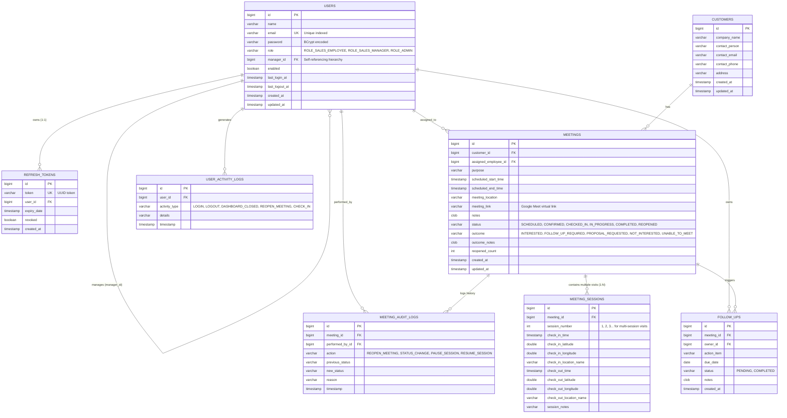

# Database Schema & Entity-Relationship (ER) Model

This document outlines the complete relational database model designed for the Optronix Sales Meeting & Visit Management System. All tables, constraints, foreign keys, indexes, and versioned migrations are managed via **Liquibase**.

---

## 📊 Entity Relationship Diagram

---

## 🔍 Table Specifications & Design Principles

### 1. `users` & `refresh_tokens`
* **Hierarchy:** `manager_id` creates a self-referencing hierarchy so Sales Managers can supervise the meetings of their assigned sales team.
* **Token Rotation:** `refresh_tokens` stores active tokens with expiry timestamps and revocation status. Once refreshed, tokens are rotated to guarantee single-use integrity.
* **Activity Tracking:** `last_login_at` and `last_logout_at` provide quick temporal auditing for executive dashboards.

### 2. `customers`
* Stores the customer/account and contact person information required for sales visits, along with company address.

### 3. `meetings` & `meeting_sessions` (Open-Ended Design Scenario)
* Rather than storing a single flat `check_in_time` and `check_out_time` directly on the meeting record, visits are modeled as a **one-to-many relationship (`meeting_sessions`)**.
* **Scenario Solution:** When a representative checks in at 10:02 AM, session #1 starts. At 10:40 AM when paused, session #1 checks out with a 38-minute elapsed time. When the representative returns at 3:10 PM, session #2 is recorded and finishes at 4:00 PM (50 minutes elapsed).
* **Benefit:** Total duration is accurately calculated as `38 + 50 = 88 minutes`, avoiding a false 6-hour duration record.

### 4. `follow_ups`
* Automatically required when a meeting outcome is set to `FOLLOW_UP_REQUIRED`.
* Enforces an owner (`owner_id`), action description, and a due date.

### 5. `meeting_audit_logs`
* Provides compliance and traceability for sensitive managerial interventions (such as reopening a completed meeting) with mandatory justification.

### 6. `user_activity_logs`
* Records user session lifecycle events: login, logout, browser window closure (`sendBeacon` API), and managerial actions.

---

## 🗂️ Liquibase Versioned Migration History

| Version | Changelog File | Operations |
| :--- | :--- | :--- |
| **01** | `01-create-users-table.xml` | Creates `users` table and `refresh_tokens` table with FK constraints. |
| **02** | `02-create-customers-table.xml` | Creates `customers` table for enterprise client directory. |
| **03** | `03-create-meetings-and-sessions.xml` | Creates `meetings`, `meeting_sessions`, `follow_ups`, and `meeting_audit_logs`. |
| **04** | `04-create-user-activity-logs.xml` | Creates `user_activity_logs` and adds `last_login_at` / `last_logout_at` to `users`. |
| **05** | `05-add-meeting-link.xml` | Adds `meeting_link` (500 chars) column to `meetings` for Google Meet virtual conferencing. |
