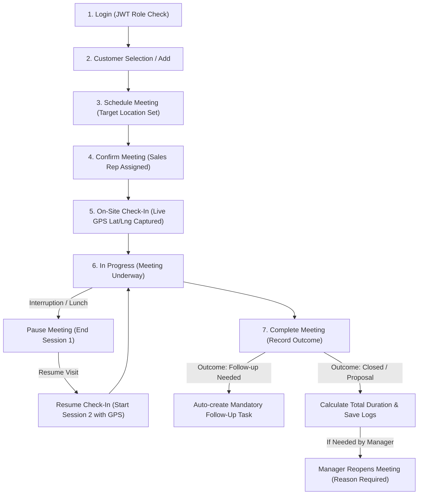

# Optronix Sales Meeting & Field Visit Management System
## 🎯 Complete Project Explanation & Interview Guide (प्रोजेक्ट गाइड)

> **उद्देश्य:** इस गाइड का उपयोग आप इंटरव्यूअर को पूरा प्रोजेक्ट शुरू से अंत तक आसानी से और तकनीकी गहराई (Technical Depth) के साथ समझाने के लिए कर सकते हैं। इसमें प्रोजेक्ट का आर्किटेक्चर, रियल-टाइम फीचर्स, डेटाबेस मॉडलिंग और संभावित इंटरव्यू प्रश्न-उत्तर शामिल हैं।

---

## 📌 1. 30-Second Elevator Pitch (प्रोजेक्ट क्या है?)

> **"Optronix एक Enterprise Full-Stack Sales Meeting & Visit Management Platform है।**  
> यह फील्ड सेल्स एग्जीक्यूटिव्स की ऑन-साइट क्लाइंट मीटिंग्स, रियल-टाइम GPS जियोलोकेशन चेक-इन, मल्टी-सेशन विज़िट्स (जैसे लंच ब्रेक या री-विज़िट), और ऑटोमेटेड फॉलो-अप्स को मैनेज करता है।  
> इसमें **Spring Boot (Java 21)**, **React 18 + Vite**, **JWT Authentication (Role-Based Access Control)**, और **Liquibase Migrations** का उपयोग किया गया है।"

---

## 🏗️ 2. Core Architecture & Tech Stack (तकनीकी ढांचा)

### Backend (Spring Boot 3.x / Java 21)
* **Modular Monolith Architecture:** कोडबेस 5 अलग-अलग डोमेन मॉड्यूल्स में बंटा हुआ है:
  1. `auth` - JWT टोकन जनरेशन, रिफ्रेश टोकन रोटेशन, पासवर्ड एन्क्रिप्शन (BCrypt)।
  2. `customer` - क्लाइंट प्रोफाइल, कॉन्टैक्ट डिटेल्स, ऑफिस एड्रेस।
  3. `meeting` - स्टेट मशीन, 1:N सेशन्स, GPS चेक-इन/चेक-आउट, आउटकम रिकॉर्डिंग।
  4. `followup` - ऑटोमेटेड टास्क क्रिएशन, ड्यू डेट्स, टास्क कम्प्लीशन।
  5. `audit` & `useractivity` - इम्यूटेबल (अपरिवर्तनीय) ऑडिट ट्रेल और लॉगिन हिस्ट्री।
* **Database & Migration:** Liquibase (Version-controlled database changes) + Spring Data JPA + H2 / PostgreSQL compatible schema.

### Frontend (React 18 + Vite)
* **SPA (Single Page Application):** मॉडर्न, रिस्पॉन्सिव डिज़ाइन सिस्टम।
* **Hardware API Integration:** HTML5 Geolocation API (`navigator.geolocation`) का उपयोग करके लाइव डिवाइस GPS कोऑर्डिनेट्स कैप्चर करना।
* **Dynamic Role Switcher:** सेल्स रिप्रेजेंटेटिव, मैनेजर, और एडमिन के बीच 1-क्लिक प्रीसेट लॉगिन।

---

## 🔄 3. End-to-End Workflow (प्रोजेक्ट कैसे काम करता है?)

### चरण 1: रोल-बेस्ड ऑथेंटिकेशन (3 Roles)
* **Sales Representative (`ROLE_SALES_EMPLOYEE`):** केवल अपनी खुद की असाइन्ड मीटिंग्स, अपनी फील्ड विज़िट्स का चेक-इन, और अपने फॉलो-अप टास्क देखता है।
* **Sales Manager (`ROLE_SALES_MANAGER`):** पूरी टीम की मीटिंग्स की प्रोग्रेस, लाइव विज़िट्स, परफॉरमेंस एनालिटिक्स और कम्प्लीट मीटिंग्स को री-ओपन (Reopen) करने का अधिकार रखता है।
* **System Admin (`ROLE_ADMIN`):** नए यूजर्स बनाना, पासवर्ड रीसेट, कंपनी-वाइड मीटिंग्स, और सभी यूजर्स के लॉगिन/लॉगआउट टाइमस्टैम्प्स देखना।

### चरण 2: मीटिंग शेड्यूलिंग (Target Location)
* जब मीटिंग शेड्यूल की जाती है, तो **Target Location / Client Address** सेट होता है (जैसे: *Cyber City, Tower B, Gurugram*)। 
* यह वह प्लांड लोकेशन है जहाँ सेल्सपर्सन को जाना है।

### चरण 3: लाइव GPS चेक-इन (Live On-Site Verification)
* जब सेल्सपर्सन क्लाइंट साइट पर पहुँचता है, तो वह **"Check In (GPS)"** पर क्लिक करता है।
* ब्राउज़र का **HTML5 Geolocation API** उसके फोन/लैपटॉप के हार्डवेयर GPS से लाइव `Latitude` और `Longitude` कैप्चर करता है।
* साथ ही `Location Name` और `Notes` भी दर्ज होते हैं।
* बैकएंड इसे `MEETING_SESSIONS` टेबल में टाइमस्टैम्प के साथ सुरक्षित करता है।

### चरण 4: मल्टी-सेशन विज़िट मॉडलिंग (1:N Relationship) - *Unique Feature*
* **रियल-वर्ल्ड समस्या:** एक फील्ड विज़िट हमेशा लगातार 1 घंटे में खत्म नहीं होती। मान लीजिए क्लाइंट लंच ब्रेक पर चला गया, या सेल्सपर्सन अगले दिन दोबारा डॉक्यूमेंट साइन कराने गया।
* **हमारा समाधान:** हमने `Meeting` और `MeetingSession` के बीच **1-to-Many (1:N)** रिलेशनशिप बनाई है:
  - पहली विज़िट = Session 1 (चेक-इन टाइम, चेक-इन GPS, चेक-आउट टाइम, चेक-आउट GPS, अवधि)।
  - दूसरी विज़िट = Session 2 (नया चेक-इन GPS, नई अवधि)।
  - सिस्टम दोनों सेशन्स की कुल अवधि जोड़कर मीटिंग की **`totalDurationMinutes`** निकालता है।

### चरण 5: मीटिंग आउटकम और मैंडेटरी फॉलो-अप
* मीटिंग खत्म करते समय सेल्सपर्सन 5 में से 1 आउटकम चुनता है:
  1. `INTERESTED`
  2. `FOLLOW_UP_REQUIRED`
  3. `PROPOSAL_REQUESTED`
  4. `NOT_INTERESTED`
  5. `UNABLE_TO_MEET`
* **बिजनेस रूल इन्फोर्समेंट:** यदि आउटकम `FOLLOW_UP_REQUIRED` है, तो सिस्टम बिना **Action Item** और **Due Date** भरे फॉर्म सबमिट नहीं होने देता। यह डेटा सीधे `FOLLOW_UPS` टेबल में चला जाता है।

### चरण 6: पूर्ण ऑडिट ट्रेल (Audit Trail)
* हर एक एक्शन (CONFIRM, CHECK_IN, PAUSE, RESUME, COMPLETE, REOPEN) का एक इम्यूटेबल रिकॉर्ड `MEETING_AUDIT_LOGS` टेबल में बनता है।
* इसमें किसने एक्शन लिया, किस टाइम पर लिया, पुराना स्टेटस क्या था और नया स्टेटस क्या बना—सब कुछ रिकॉर्ड होता है।

---

## 🗄️ 4. Database Schema (Entities & Relationships)

| Entity Name | Description | Key Fields |
| :--- | :--- | :--- |
| **`USERS`** | सिस्टम यूजर्स और उनकी भूमिकाएं | `id`, `email`, `role`, `is_active` |
| **`CUSTOMERS`** | क्लाइंट प्रोफाइल्स | `company_name`, `contact_name`, `address` |
| **`MEETINGS`** | मुख्य मीटिंग रिकॉर्ड | `status`, `target_location`, `outcome`, `total_duration_minutes` |
| **`MEETING_SESSIONS`** | हर विज़िट का GPS व टाइम सेशन (1:N) | `check_in_time`, `check_in_latitude`, `check_in_longitude`, `check_in_location_name`, `check_out_time` |
| **`FOLLOW_UPS`** | मीटिंग से जुड़े पोस्ट-मीटिंग टास्क | `action_item`, `due_date`, `status` (`PENDING`/`COMPLETED`) |
| **`MEETING_AUDIT_LOGS`**| जीवनचक्र बदलावों का ऑडिट ट्रेल | `action`, `previous_status`, `new_status`, `timestamp`, `performed_by` |
| **`USER_ACTIVITY_LOGS`**| सुरक्षा और लॉगिन हिस्ट्री | `user_id`, `action` (`LOGIN`/`LOGOUT`), `timestamp`, `ip_address` |

---

## 💬 5. Interview Questions & Ready Answers (इंटरव्यू में क्या बोलें?)

### Q1: "क्या सेल्सपर्सन कहीं से भी मीटिंग स्टार्ट कर सकता है या सिर्फ एग्जैक्ट लोकेशन से?"
> **जवाब:** "मीटिंग शेड्यूल करते समय टारगेट लोकेशन (जैसे क्लाइंट ऑफिस) तय होती है। जब सेल्सपर्सन मीटिंग स्टार्ट करता है, तो सिस्टम उसके डिवाइस के **HTML5 Geolocation API** से लाइव GPS कोऑर्डिनेट्स (Lat/Lng) और टाइमस्टैम्प कैप्चर करके डेटाबेस में सेव करता है।  
> हमने हार्ड जियो-फेंसिंग (Hard Geofencing) से सेल्सपर्सन को ब्लॉक नहीं किया, क्योंकि रियल वर्ल्ड में क्लाइंट अक्सर पास के कैफे या दूसरे ब्लॉक में मीटिंग शिफ्ट कर देता है। लेकिन दोनों लोकेशन्स का अंतर और कोऑर्डिनेट्स ऑडिट लॉग में परमानेंटली सेव हो जाते हैं, जिससे मैनेजर इसे 100% वेरीफाई कर सकता है।"

### Q2: "आपने 1:1 के बजाय 1:N (Multi-Session) आर्किटेक्चर क्यों चुना?"
> **जवाब:** "अगर हम 1:1 (एक मीटिंग = एक चेक-इन/चेक-आउट) रखते, तो बीच में ब्रेक होने पर या क्लाइंट द्वारा अगले दिन दोबारा बुलाने पर सिस्टम फेल हो जाता या सेल्सपर्सन को फर्जी नई मीटिंग बनानी पड़ती। 1:N सेशन मॉडलिंग से एक ही मीटिंग टिकट के अंदर मल्टीपल ऑन-साइट विज़िट्स और उनकी सही कुल अवधि (Total Duration) बिना डेटा डुप्लीकेशन के ट्रैक हो जाती है।"

### Q3: "प्रोजेक्ट में सिक्योरिटी कैसे लागू की गई है?"
> **जवाब:** "हमने **Stateless JWT Authentication** लागू किया है। इसमें शॉर्ट-लिव्ड एक्सेस टोकन (15 मिनट) और डेटाबेस-रिफ्रेश टोकन रोटेशन है। बैकएंड में Spring Security के मेथड-लेवल `@PreAuthorize` एनोटेशन से सुनिश्चित किया गया है कि सेल्सपर्सन किसी दूसरे कर्मचारी का डेटा न देख सके और केवल मैनेजर ही मीटिंग री-ओपन कर सके।"

### Q4: "डेटाबेस माइग्रेशन के लिए Liquibase क्यों इस्तेमाल किया?"
> **जवाब:** "प्रोडक्शन एनवायरनमेंट में `ddl-auto: update` खतरनाक होता है। Liquibase के XML चेंजलॉग्स के जरिए डेटाबेस स्कीमा का हर बदलाव गिट की तरह वर्ज़न-कंट्रोल्ड (Version-Controlled) रहता है, जिससे बिना डेटा लॉस के रोलबैक या अपडेट सुरक्षित तरीके से किया जा सकता है।"

### Q5: "भविष्य में इस सिस्टम को 1 लाख सेल्सपर्सन के लिए कैसे स्केल करेंगे?"
> **जवाब:** 
> 1. **PostGIS Integration:** GPS कोऑर्डिनेट्स के लिए PostgreSQL के PostGIS एक्सटेंशन से स्पेशल इंडेक्सिंग और ऑटोमेटेड जियो-फेंसिंग।
> 2. **Redis Caching:** एक्टिव मीटिंग्स और सेशन काउंट्स को इन-मेमोरी कैश करना ताकि डेटाबेस पर रीड लोड कम हो।
> 3. **Kafka Event Streaming:** ऑडिट लॉग्स और यूजर एक्टिविटी लॉग्स को एसिंक्रोनस (Asynchronous) इवेंट्स के रूप में प्रोसेस करना।

---

## 🚀 6. Demo Credentials (डेमो के लिए खाते)

| Role | Email | Password |
| :--- | :--- | :--- |
| **Sales Representative** | `employee@optronix.com` | `password123` |
| **Sales Manager** | `manager@optronix.com` | `password123` |
| **System Admin** | `admin@optronix.com` | `password123` |

---
*Created for Optronix Sales Visit & Meeting Management Interview Assignment.*
