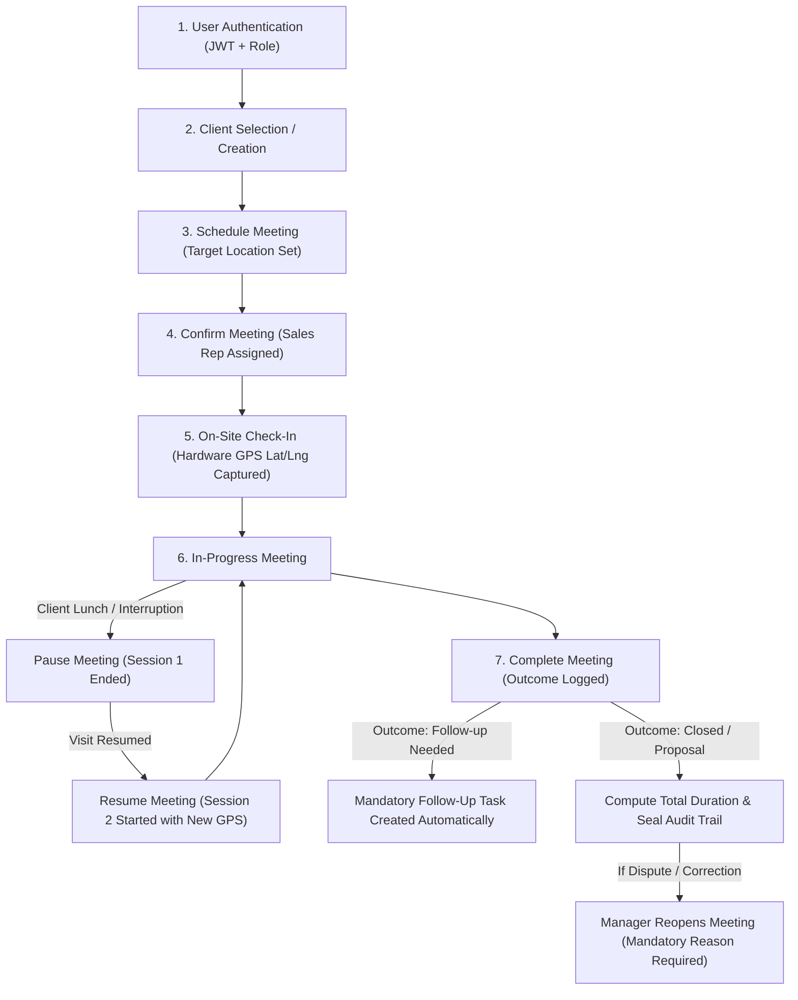

# Optronix Sales Meeting & Field Visit Management System
## 🎯 Comprehensive Project Explanation & Technical Interview Guide

> **Purpose:** This document is designed to give you a complete, clear, and professional walkthrough of the entire project in plain English. Use this guide to understand the system architecture, real-world business logic, database design, and to answer any interview questions with confidence.

---

## 📌 1. Executive Summary (The 30-Second Elevator Pitch)

> **"Optronix is a full-stack, enterprise-grade Sales Meeting and Field Visit Management platform.**  
> It solves the core problem of tracking sales representatives on the field, verifying their physical presence through **real-time hardware GPS geolocation**, handling real-world visit interruptions via **1-to-many (1:N) visit sessions**, and enforcing **mandatory follow-up workflows** for sales pipeline integrity.  
> The system is built with **Spring Boot 3 (Java 21)**, **React 18 + Vite**, **Stateless JWT Authentication with Role-Based Access Control (RBAC)**, and **Liquibase version-controlled database migrations**."

---

## 🏗️ 2. Core Architecture & Tech Stack

### Backend: Spring Boot 3.x (Java 21)
* **Modular Monolith Pattern:** Organized into isolated, high-cohesion domain modules:
  1. `auth` — JWT access/refresh token generation, token rotation, BCrypt password hashing, and role checks.
  2. `customer` — Client profiles, contact persons, corporate addresses, and industry segments.
  3. `meeting` — Meeting state machine, session tracking, GPS check-in/out coordinates, and outcome logging.
  4. `followup` — Automated post-meeting task generation, ownership assignment, and completion tracking.
  5. `audit` & `useractivity` — Immutable compliance audit logs and user session telemetry (login/logout).
* **Database & Migrations:** 
  - Version-controlled incremental schema evolution using **Liquibase XML changelogs**.
  - Production-ready Spring Data JPA entities with relational integrity, cascading rules, and optimized fetch strategies.
  - Compatible with H2 (development) and PostgreSQL / MySQL (production).

### Frontend: React 18 + Vite
* **Single Page Application (SPA):** High-speed, responsive component hierarchy.
* **Native Hardware Geolocation:** Uses HTML5 Geolocation API (`navigator.geolocation.getCurrentPosition`) to fetch high-precision device GPS coordinates directly from the user's hardware.
* **Multi-Role Workspace:** Dynamic UI adapts instantly depending on whether the logged-in user is a **Sales Representative**, **Sales Manager**, or **System Administrator**.

---

## 🔄 3. End-to-End Workflow & Business Logic

### Step 1: Role-Based Access Control (3 Discrete Roles)
1. **Sales Representative (`ROLE_SALES_EMPLOYEE`):**
   - Access is restricted exclusively to meetings assigned to them.
   - Can check in with live GPS, record visit notes, pause/resume sessions, log meeting outcomes, and complete follow-up tasks.
2. **Sales Manager (`ROLE_SALES_MANAGER`):**
   - Team-wide oversight: views all field visits across all sales reps.
   - Access to team analytics, live active GPS sessions, and audit histories.
   - **Exclusive Privilege:** Has the authorization to reopen a completed meeting if additional customer discussions are required.
3. **System Administrator (`ROLE_ADMIN`):**
   - System governance: user account provisioning, role assignment, credential resets.
   - Security auditing: views user login/logout timestamps and IP records.

---

### Step 2: Scheduling & Planning (Target Location)
* When a manager or sales rep schedules a meeting, they specify the **Target Location** (e.g., *Acme Corp HQ, Cyber City, Tower B, Gurugram*).
* This defines the planned destination where the physical meeting is supposed to happen.

---

### Step 3: Real-Time On-Site GPS Check-In
* When the salesperson arrives at the client's office, they open the meeting and click **"Check In (GPS)"**.
* The application invokes `navigator.geolocation.getCurrentPosition()`:
  - Fetches real-time `Latitude` and `Longitude` from the device hardware.
  - Automatically populates the `Check-in Location / Venue Name` (defaults to client office, editable if venue changed).
  - Accepts check-in operational notes (e.g., *"Arrived at 4th floor reception"*).
* The backend API `POST /api/meetings/{id}/check-in` creates a new record in `MEETING_SESSIONS` with the exact server timestamp and hardware coordinates.
* **Why this matters:** The manager can compare the scheduled target address with the actual GPS coordinates to verify physical presence and eliminate fake check-ins.

---

### Step 4: Multi-Session Tracking (1:N Sessions) — *Key Architectural Decision*
* **The Problem:** In field sales, meetings rarely happen in one unbroken block. A client might take an urgent phone call, step out for lunch, or ask the sales rep to return the next morning.
* **Our Solution:** A `Meeting` can have **multiple `MeetingSession` records (1:N)**:
  - **First visit:** Session #1 begins with GPS coordinates; paused when client steps out.
  - **Second visit:** Session #2 begins with fresh GPS coordinates when the meeting resumes.
  - **Accurate Duration:** The system calculates the exact working duration of each session independently and aggregates them into `totalDurationMinutes`.
  - **No Duplicate Data:** The salesperson does not need to create confusing duplicate meeting tickets for the same deal.

---

### Step 5: Meeting Outcomes & Enforced Follow-Ups
* When closing a meeting, the sales rep must select 1 of 5 standard business outcomes:
  1. `INTERESTED`
  2. `FOLLOW_UP_REQUIRED`
  3. `PROPOSAL_REQUESTED`
  4. `NOT_INTERESTED`
  5. `UNABLE_TO_MEET`
* **Enforced Business Constraint:** If the outcome is `FOLLOW_UP_REQUIRED` or `PROPOSAL_REQUESTED`, the UI and backend strictly enforce that an **Action Item** and a **Due Date** are provided. The system automatically inserts a linked task into the `FOLLOW_UPS` table so leads never fall through the cracks.

---

### Step 6: Immutable Compliance & Audit Trail
* Every status transition (`SCHEDULED` ➔ `CONFIRMED` ➔ `CHECKED_IN` ➔ `IN_PROGRESS` ➔ `PAUSED` ➔ `COMPLETED` ➔ `REOPENED`) writes a permanent row into `MEETING_AUDIT_LOGS`.
* Each audit entry captures:
  - `action`: Type of action performed
  - `from_status` & `to_status`: The state transition
  - `performed_by`: Full name and email of the user
  - `timestamp`: Exact UTC/local time
  - `remarks`: Contextual reason (e.g., manager reason for reopening)

---

## 🗄️ 4. Database Schema & Data Model

| Table Name | Primary Purpose | Critical Columns |
| :--- | :--- | :--- |
| **`USERS`** | System credentials and roles | `id`, `email`, `password_hash`, `role`, `is_active` |
| **`REFRESH_TOKENS`** | Secure session management & rotation | `token`, `user_id`, `expiry_date`, `revoked` |
| **`CUSTOMERS`** | Client directory & accounts | `company_name`, `contact_name`, `email`, `address`, `industry` |
| **`MEETINGS`** | Master meeting entity | `customer_id`, `assigned_user_id`, `status`, `target_location`, `outcome`, `total_duration_minutes` |
| **`MEETING_SESSIONS`** | 1:N visit sessions with GPS | `meeting_id`, `session_number`, `check_in_time`, `check_in_latitude`, `check_in_longitude`, `check_in_location_name`, `check_out_time`, `session_notes` |
| **`FOLLOW_UPS`** | Action items created from meetings | `meeting_id`, `assigned_to`, `action_item`, `due_date`, `status` (`PENDING`/`COMPLETED`) |
| **`MEETING_AUDIT_LOGS`** | Tamper-proof audit history | `meeting_id`, `action`, `previous_status`, `new_status`, `performed_by_id`, `timestamp`, `details` |
| **`USER_ACTIVITY_LOGS`** | Login and security tracking | `user_id`, `action` (`LOGIN`/`LOGOUT`), `timestamp`, `ip_address` |

---

## 💡 5. Common Interview Questions & How to Answer Them

### Question 1: "Does the meeting start only from the exact target location, or can a sales person start it from anywhere?"
> **Answer:**  
> "When scheduling a meeting, a **Target Location** (e.g., the client's corporate office) is recorded as the expected destination. When the sales representative clicks Check-In, the system queries the device's **HTML5 Geolocation API** to capture their **live hardware GPS Latitude and Longitude** along with the timestamp.  
> We deliberately chose **not to implement hard geofencing blocks** because in real-world sales, clients frequently move meetings to an adjacent cafeteria or nearby branch. Instead, the system records the exact physical GPS coordinates and venue name into the audit log, enabling managers to verify whether the check-in occurred at the client site or elsewhere."

---

### Question 2: "Why did you design a 1-to-Many (1:N) Meeting Session model instead of 1-to-1?"
> **Answer:**  
> "A traditional 1-to-1 relationship (one check-in and one check-out per meeting) breaks down when real-life interruptions occur—such as when a client pauses for lunch, or asks the rep to return the next morning with contracts.  
> With our 1:N session architecture, a single meeting ticket can hold multiple discrete physical visits. Each session preserves its own check-in/out time and GPS coordinates. The system sums the active durations into a single accurate total without forcing reps to create fake duplicate meetings."

---

### Question 3: "How is application security implemented?"
> **Answer:**  
> "Security is built on **stateless Spring Security with JWT**.  
> 1. Authentication generates a short-lived Access Token (15 minutes) and a persistent Refresh Token stored in the database.  
> 2. We implement **Refresh Token Rotation**: whenever an access token is refreshed, the old refresh token is invalidated to prevent replay attacks.  
> 3. Authorization uses method-level `@PreAuthorize` guards so that sales reps can strictly only access their own assigned records, while managerial operations (such as reopening a meeting) are restricted by role."

---

### Question 4: "Why use Liquibase instead of `ddl-auto: update`?"
> **Answer:**  
> "`ddl-auto: update` is unsafe for production environments because it can cause unintended data corruption, cannot handle column renames safely, and offers no rollback strategy. Liquibase provides version-controlled, reproducible XML changelogs that track every database migration step, ensuring schema parity across development, staging, and production."

---

### Question 5: "How would you scale this architecture for 100,000 active sales reps?"
> **Answer:**  
> "I would evolve the architecture across three layers:  
> 1. **Spatial Queries:** Migrate the GPS columns to **PostgreSQL with PostGIS** (`GEOMETRY(Point, 4326)`) and apply spatial indexing (`GIST`) to execute sub-millisecond geofence and proximity queries.  
> 2. **Caching:** Introduce **Redis** to cache user permissions and active session metadata, drastically reducing relational database reads.  
> 3. **Asynchronous Telemetry:** Route high-frequency audit logs and GPS tracking pings through an **Apache Kafka** event stream to decouple writes from transactional meeting operations."

---

## 🔑 6. Demo Accounts (For Live Evaluation)

| Role | Email | Password | Scope of Access |
| :--- | :--- | :--- | :--- |
| **Sales Representative** | `employee@optronix.com` | `password123` | Personal assigned meetings, GPS check-in, personal follow-ups |
| **Sales Manager** | `manager@optronix.com` | `password123` | Team-wide dashboard, reopening completed meetings, team analytics |
| **System Administrator** | `admin@optronix.com` | `password123` | User provisioning, audit trails, login telemetry |

---
*Created for the Optronix Sales Meeting & Visit Management System.*
